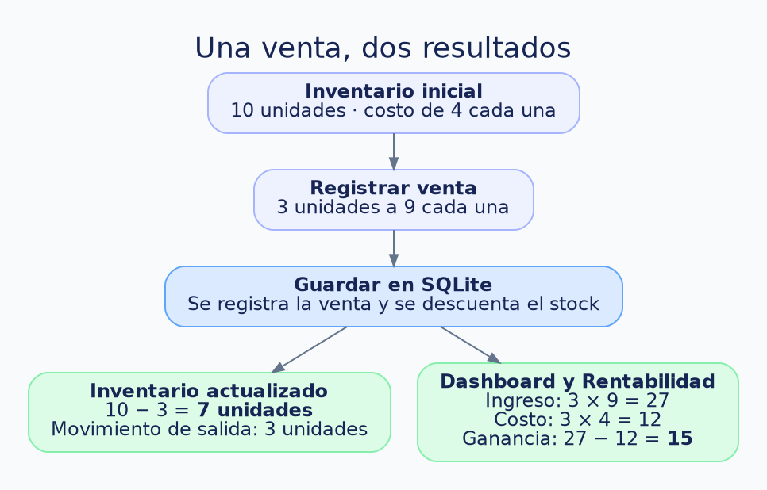
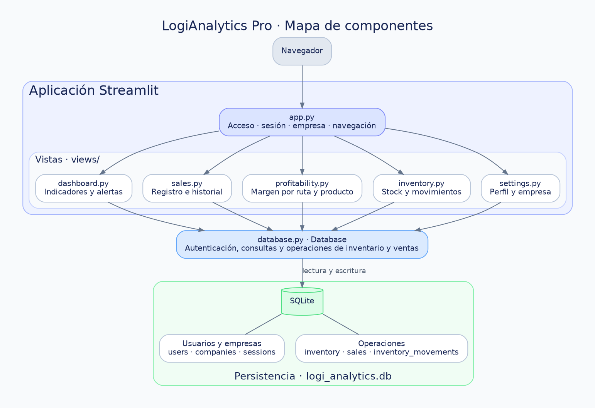
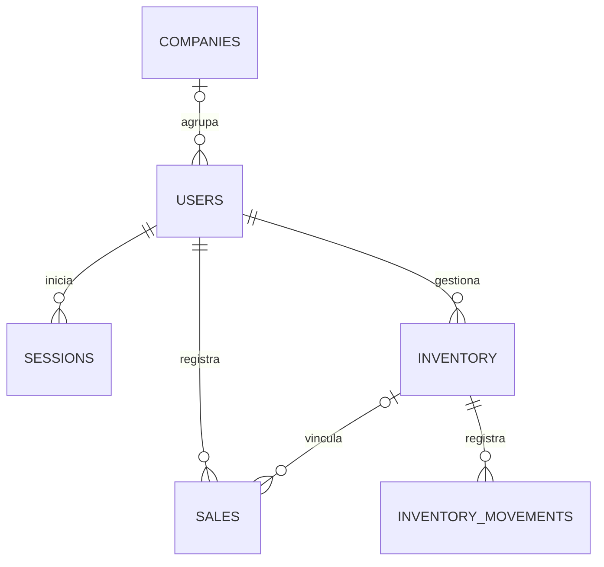
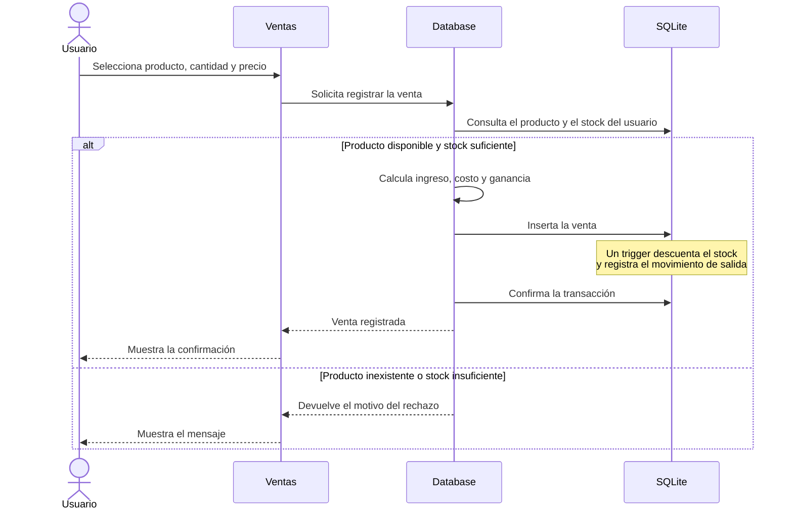

<p align="center">
  
</p>

# LogiAnalytics Pro

Aplicación web para gestionar inventario, registrar ventas y consultar la rentabilidad por producto y por ruta. Cada venta asociada a un producto actualiza sus existencias y deja un registro del movimiento.

[Una venta paso a paso](#una-venta-paso-a-paso) · [Arquitectura](#arquitectura) · [Estructura del repositorio](#estructura-del-repositorio) · [Inicio rápido](#inicio-rápido) · [Verificación](#verificación)

| Tecnología | Función en la app |
| --- | --- |
|  | Ejecuta la lógica de la aplicación. |
|  | Presenta las pantallas, los formularios y la navegación. |
|  | Guarda usuarios, inventario, ventas y movimientos. |
|  | Dibuja los gráficos de los módulos de análisis. |

**Recorrido en la app** · Iniciar sesión → Configurar empresa u omitir → Agregar producto → Registrar venta → Consultar Dashboard o Rentabilidad.

## Una venta paso a paso



### Dónde seguir el recorrido en el código

| Lo que haces o ves en la aplicación | Dónde ocurre |
| --- | --- |
| Das de alta un producto y defines el stock y el costo. | [Inventario](views/inventory.py) |
| Seleccionas el producto e ingresas cantidad y precio. | [Ventas](views/sales.py) |
| Se valida el stock, se guarda la venta y SQLite registra la salida. | [`register_sale()` y el trigger `trg_sale_auto_inventory`](database.py) |
| Consultas las existencias, los ingresos y la ganancia. | [Inventario](views/inventory.py), [Dashboard](views/dashboard.py) y [Rentabilidad](views/profitability.py) |

## Arquitectura



[`app.py`](app.py) gestiona el acceso, la sesión y la navegación. Cada vista de [`views/`](views/) reúne los formularios, tablas o gráficos de su módulo. Las vistas llaman a [`database.py`](database.py), que concentra las consultas y las escrituras en SQLite. `app.py` también lo usa para gestionar cuentas y sesiones.

<details>
<summary>Ver relaciones entre las tablas</summary>

El diagrama muestra las relaciones que usa el código mediante identificadores.



</details>

<details>
<summary>Ver la secuencia técnica de una venta</summary>



</details>

| Vista | Función |
| --- | --- |
| **Dashboard** | Resume ingresos, ganancias, ventas, valor de inventario y alertas de stock. |
| **Ventas** | Registra ventas, muestra el historial y permite descargarlo en CSV. |
| **Rentabilidad** | Compara ingresos, costos y márgenes por producto y ruta. |
| **Inventario** | Gestiona productos, niveles de stock y movimientos. Permite importar y exportar CSV. |
| **Configuración** | Permite gestionar los datos del perfil y de la empresa. |

## Estructura del repositorio

```text
logianalytics-pro/
├── app.py                          # Punto de entrada, acceso y navegación
├── database.py                     # Esquema SQLite y operaciones de datos
├── views/
│   ├── dashboard.py                # Indicadores y alertas
│   ├── sales.py                    # Registro e historial de ventas
│   ├── profitability.py            # Rentabilidad por producto y ruta
│   ├── inventory.py                # Productos, existencias y movimientos
│   └── settings.py                 # Perfil y empresa
├── .streamlit/config.toml          # Configuración y tema de Streamlit
├── static/                         # Iconos y manifiesto web
├── requirements.txt                # Dependencias de Python
├── test_app.py                     # Script de comprobación de una versión anterior
└── LogiAnalytics_Pro_Complete/      # Implementaciones y archivos de hosting anteriores
```

Para ejecutar o modificar la aplicación principal, usa [`app.py`](app.py), [`views/`](views/) y [`database.py`](database.py) en la raíz del repositorio. Allí está el flujo descrito en los diagramas.

Los diagramas se generan con Graphviz a partir de [arquitectura.dot](docs/arquitectura.dot) y [recorrido-venta.dot](docs/recorrido-venta.dot).

## Inicio rápido

Los siguientes comandos usan un entorno virtual y funcionan en macOS y Linux. La instalación se verificó con **Python 3.12**.

```bash
git clone https://github.com/umberto022/logianalytics-pro.git
cd logianalytics-pro
python -m venv .venv
source .venv/bin/activate
python -m pip install -r requirements.txt
python -m streamlit run app.py
```

En Windows PowerShell, activa el entorno con `.\.venv\Scripts\Activate.ps1`.

Abre **http://localhost:8501** y usa la pestaña **Crear cuenta** para empezar. Puedes registrar una empresa durante la configuración inicial u omitir ese paso. La aplicación inicializa `logi_analytics.db` en la raíz al acceder por primera vez a la base de datos. Ese archivo guarda los datos entre ejecuciones y está excluido de Git.

## Verificación

1. Crea una cuenta e inicia sesión.
2. En **Inventario**, agrega un producto con 10 unidades y un costo unitario de 4.
3. En **Ventas**, registra 3 unidades de ese producto a un precio unitario de 9 y asigna una ruta.
4. Comprueba que quedan 7 unidades en **Inventario** y que aparece el movimiento de salida.
5. Consulta **Dashboard** y **Rentabilidad**. La venta debe sumar 27 de ingresos y 15 de ganancia en el período correspondiente.

El script [`test_app.py`](test_app.py) todavía espera la estructura y la interfaz de base de datos de una versión anterior. La comprobación anterior recorre el flujo de la aplicación actual.
